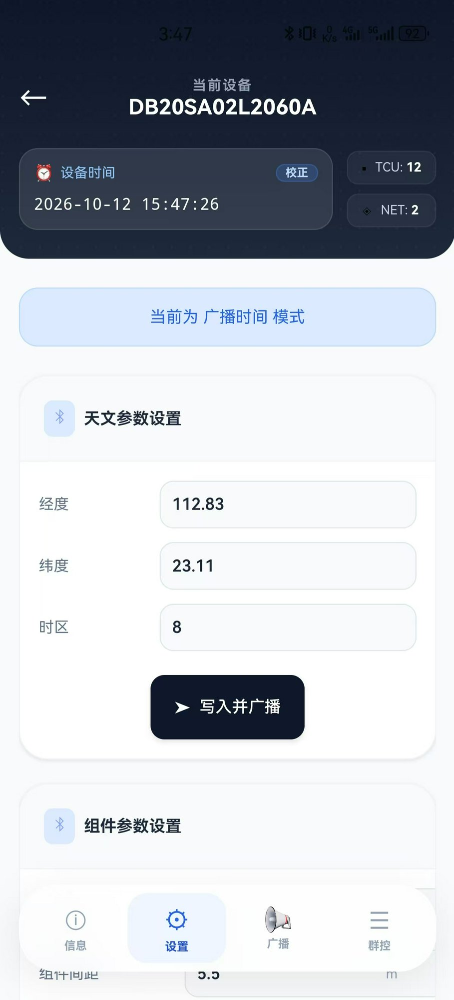

# youjuAPP

太阳能智能跟踪支架控制器（TCU）移动端蓝牙管理应用。

---

## 🚀 快速下载与安装

- **当前最新稳定版**：`v2.1.1` (Build `2110`)
- **APK 直接下载**：👉 [**youjuAPP_v2.1.1.apk (53.9 MB)**](download/v2.1.1/youjuAPP_v2.1.1.apk)
- **全部版本更新记录**：👉 [**查看详细更新日志 (CHANGELOG.md)**](CHANGELOG.md)

---

## ✨ 核心特性

- **Flutter 原生高帧率体验**：告别旧版 uni-app WebView 掉帧与性能瓶颈，采用 Google Material 3 现代工业风设计规范。
- **经典蓝牙 SPP + BLE 双模底座**：原生 Kotlin 插件 (`BluetoothSppPlugin.kt`) 实现标准 RFCOMM 通信，彻底解决工业下位机（JDY-31 / HC-05 等）连接难题。
- **官方交接协议全面对齐**：完整支持以 `\r\n` 分帧的 UTF-8 JSON 遥测解析、5 台 TCU 实时状态监控大盘与 10 项标准群控指令。
- **现场调试控制台**：内置滑出式报文监控抽屉，实时显示 Hex / ASCII 双向交互日志，支持一键清屏与自动滚动。
- **健壮的人机交互**：前置拦截物理蓝牙未开启状态，自动调用系统原生开启弹窗；Tab 胶囊指示平滑无遮罩残留。

---

## 📚 开发与联调文档

- 📖 [更新日志 (CHANGELOG.md)](CHANGELOG.md)
- 🛠️ [经典蓝牙SPP与下位机NCU本地联调测试指南](docs/20261107调试文档/经典蓝牙SPP与下位机NCU本地联调测试指南.md)
- 🐍 [配套下位机 Python 仿真器 (mock_ncu_server.py)](docs/20261107调试文档/mock_ncu_server.py)
- 📋 [官方交接文档：NCU与Android App蓝牙通信数据结构 V1.0](docs/20261106交接文档/交接文档_NCU与Android_App蓝牙通信数据结构_V1.0.md)
- 🌐 [官方交接文档：NCU与上位机MQTT通信数据结构 V1.0](docs/20261106交接文档/交接文档_NCU与上位机MQTT通信数据结构_V1.0.md)
